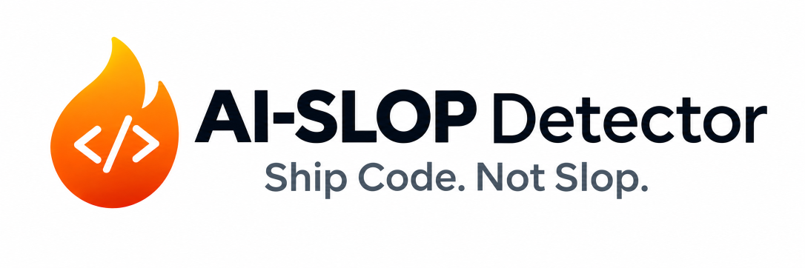
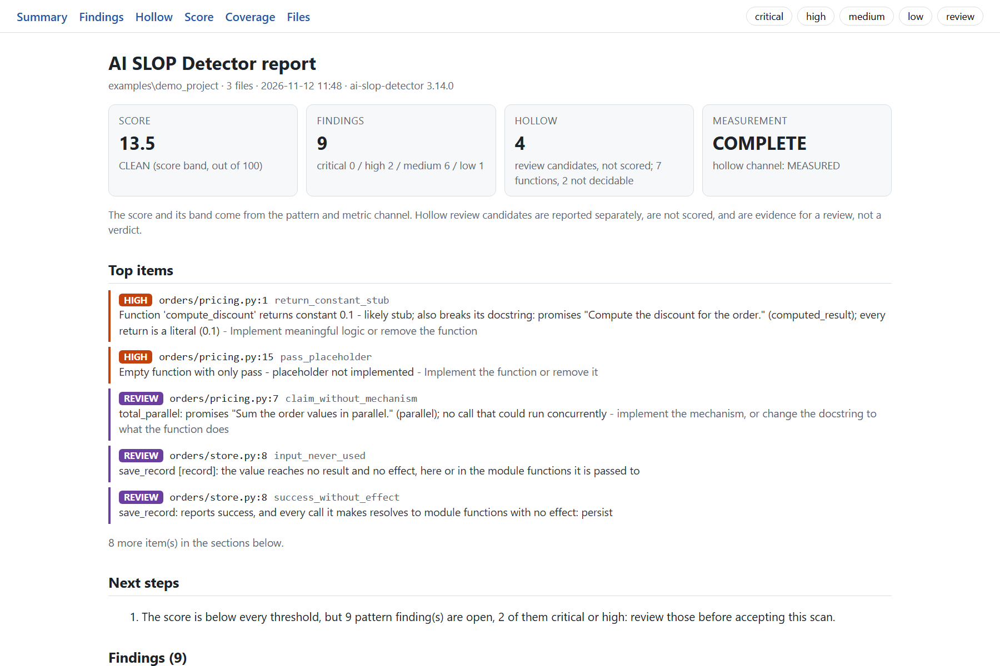
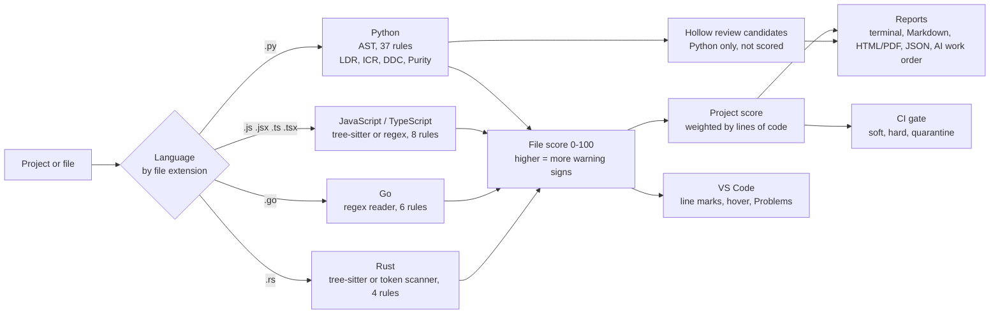

<p align="center">
  
</p>

<p align="center">
Find warning signs of unfinished code in Python, JavaScript/TypeScript, Go, and Rust.<br/>
<b>Runs locally. No API key required.</b>
</p>

<p align="center">
  <a href="https://pypi.org/project/ai-slop-detector/"></a>
  <a href="https://pepy.tech/project/ai-slop-detector"></a>
  <a href="https://www.npmjs.com/package/ai-slop-detector"></a>
  <a href="https://marketplace.visualstudio.com/items?itemName=Flamehaven.vscode-slop-detector"></a>
  <a href="https://www.python.org/downloads/"></a>
  <a href="https://github.com/flamehaven01/AI-SLOP-Detector/actions"></a>
  <a href="https://opensource.org/licenses/MIT"></a>
</p>

<!-- Hero image: replace with the VS Code Problems screenshot (lib.rs, App.jsx, Panel.tsx) once it is captured. -->
<p align="center">
  
</p>

Code can look finished and still hide a stub, a swallowed error, an input
nothing reads, or a `todo!()` that panics when it is reached. Linters pass it
because it is well-formed. AI-SLOP Detector reports these spots with the file,
the line and a fix, and gives each file a score.

---

## Quick Start

```bash
pip install ai-slop-detector
slop-detector --project .
```

| Next | Command |
|---|---|
| One file | `slop-detector path/to/file.py` |
| All reports in one folder (Markdown, HTML, PDF with an installed Chrome or Edge, AI report and work order, JSON) | `slop-detector --project . --report-dir slop-report` |
| JSON for scripts (UTF-8, safe on Windows PowerShell) | `slop-detector --project . --json --output slop.json` |
| Fail a CI build | `slop-detector --project . --ci-mode hard --ci-report` |
| No install | `uvx ai-slop-detector --project .` or `npx ai-slop-detector --project .` |

Every command and option: [docs/GUIDE.md](https://github.com/flamehaven01/AI-SLOP-Detector/blob/main/docs/GUIDE.md#all-commands).

## Languages

| Language | Files | Read by (base install) | Optional extra (Python 3.10+) | Rules |
|---|---|---|---|---|
| Python | `.py` | Python AST | - | 37 |
| JavaScript / TypeScript | `.js` `.jsx` `.ts` `.tsx` | regex reader (god functions, dead code and complexity are not measured) | `[js]`: tree-sitter, measures all 8 | 8 |
| Go | `.go` | regex reader, measures every Go rule | `[go]` installs tree-sitter-go; the analyzer does not use it yet | 6 |
| Rust | `.rs` | token scanner, measures every Rust rule | `[rust]`: tree-sitter, same findings | 4 |

```bash
pip install "ai-slop-detector[js]"     # or [rust]; on Python 3.8/3.9 the base install reads these files
```

Rule counts come from the pattern registry in [docs/PATTERNS.md](https://github.com/flamehaven01/AI-SLOP-Detector/blob/main/docs/PATTERNS.md)
(55 rules), which a test keeps in line with the analyzers. A scan says which
reader ran for each language (`scan_coverage.analysis_modes`).

## What It Detects

| Language | Example | Rules (sample) |
|---|---|---|
| Python | a function that returns a constant where its docstring promises a computed result; a handler that turns a failure into success; a parameter nothing reads; an import of a package that does not exist | `return_constant_stub`, `failure_as_success`, `ignored_parameter`, `phantom_import` |
| JavaScript / TypeScript | `any` types, empty arrow functions, `==`, leftover `console.log` | `js_any_type`, `js_empty_arrow`, `js_double_equals`, `js_console_log` |
| Go | ignored errors, `panic()` as error handling, empty functions | `go_ignored_error`, `go_panic`, `go_empty_func` |
| Rust | `todo!()` and `unimplemented!()` outside test code, leftover `dbg!()` | `rust_todo_macro`, `rust_unimplemented_macro`, `rust_dbg_macro` |

Each finding names the file, the line, the rule and a fix. From
[`examples/demo_project`](https://github.com/flamehaven01/AI-SLOP-Detector/tree/main/examples/demo_project):

```text
HIGH     orders/pricing.py:1  return_constant_stub
         Function 'compute_discount' returns constant 0.1 - likely stub; also breaks its docstring:
         promises "Compute the discount for the order." (computed_result); every return is a literal (0.1)
         fix: Implement meaningful logic or remove the function
```

Python files also get **hollow review candidates**: functions that report
success with no effect, inputs that reach nothing, docstring promises the body
cannot keep. They are listed for review and never change the score.

All 55 rules: [docs/PATTERNS.md](https://github.com/flamehaven01/AI-SLOP-Detector/blob/main/docs/PATTERNS.md).

## Reading The Result

- **Higher score = more warning signs.** Each file gets a deficit score from
  0 to 100; the project score weights files by their lines of code.

  | Score | Status |
  |---|---|
  | < 30 | `CLEAN` |
  | 30 - 50 | `SUSPICIOUS` |
  | 50 - 70 | `INFLATED_SIGNAL` |
  | >= 70 | `CRITICAL_DEFICIT` |

- **`CLEAN` is a score band, not "no findings".** A clean project can still
  have open findings; its next steps then say how many, and how many are
  critical or high.
- **Nothing measured is not clean.** When no file could be analyzed, reports
  read `NOT EVALUATED`, and `--fail-threshold` fails.
- **Findings are leads, not verdicts.** The tool reads code statically: it
  does not run it, and it does not tell whether a person or an AI wrote it.

How the score is computed: [docs/GUIDE.md](https://github.com/flamehaven01/AI-SLOP-Detector/blob/main/docs/GUIDE.md#scoring-model) and
[docs/MATH_MODELS.md](https://github.com/flamehaven01/AI-SLOP-Detector/blob/main/docs/MATH_MODELS.md).

## How It Works



The same input gives the same output: scoring is deterministic and needs no
model or network. Details: [docs/HOW_IT_WORKS.md](https://github.com/flamehaven01/AI-SLOP-Detector/blob/main/docs/HOW_IT_WORKS.md).

## Where It Runs

| Where | How |
|---|---|
| **VS Code** | Findings on the line, in a hover with the fix, in Problems and a sidebar, for all four languages. [Marketplace](https://marketplace.visualstudio.com/items?itemName=Flamehaven.vscode-slop-detector) · [extension guide](https://github.com/flamehaven01/AI-SLOP-Detector/blob/main/vscode-extension/README.md) |
| **CI** | `--ci-mode soft / hard / quarantine` judges every analyzed file: Python, JS/TS, Go and Rust. pre-commit hooks and GitHub Actions: [CI/CD integration](https://github.com/flamehaven01/AI-SLOP-Detector/blob/main/docs/GUIDE.md#cicd-integration) · [docs/CI_CD.md](https://github.com/flamehaven01/AI-SLOP-Detector/blob/main/docs/CI_CD.md) |
| **AI agents** | An AI work order (`--format ai-md`) that binds every item to the SHA-256 of the scanned file; an MCP server (`slop-detector mcp`); a Claude Code skill. [docs/AI_WORK_ORDER.md](https://github.com/flamehaven01/AI-SLOP-Detector/blob/main/docs/AI_WORK_ORDER.md) · [docs/CLAUDE_CODE_SKILL.md](https://github.com/flamehaven01/AI-SLOP-Detector/blob/main/docs/CLAUDE_CODE_SKILL.md) |
| **Node projects** | `npx ai-slop-detector` runs the same Python backend; typed results at `ai-slop-detector/types`. [docs/GUIDE.md](https://github.com/flamehaven01/AI-SLOP-Detector/blob/main/docs/GUIDE.md#all-commands) |
| **REST** | A local FastAPI server (`[api]` extra) that binds `127.0.0.1`. [docs/API.md](https://github.com/flamehaven01/AI-SLOP-Detector/blob/main/docs/API.md) |

<!-- VS Code screenshots (Rust inline view, multi-language Problems, hover with Fix) go here once captured. -->

---

## Why Not Just Use a Linter?

Ruff, pylint, ESLint, and SonarQube primarily check syntax, style, and general static-quality rules. They'll happily pass code that follows every rule and still does nothing — which is exactly what AI assistants tend to produce. This tool checks the other half: **does the code contain structural evidence for what it and its docs claim?** Structural evidence is not proof that a claim is true; the tool does not run your code.

| Can it catch... | ruff / pylint / SonarQube | AI-SLOP Detector |
|---|---|---|
| Style, formatting, syntax | Yes | No (not its job) |
| An empty function with a real-looking body or fake return | No | Yes |
| A module imported but never actually used downstream | Partial (unused-import) | Yes (usage ratio) |
| A handler or pipeline that's defined but never wired in | No | Yes |
| Docs or comments that oversell what the code does | No | Yes |
| Copy-pasted duplicate functions across files | Partial | Partial (exact duplicates) |
| Runs offline, no API key, deterministic core score | Yes | Yes |

Use a linter for correctness-of-form. Use this for "is this code real, or just plausible-looking." The two are complementary — run both.

## When NOT to Use This

- **You want style or formatting enforcement** — use ruff / black / ESLint. This tool ignores style on purpose.
- **You need a runtime correctness guarantee** — a low score means cleaner structure, not that the code works. Keep your tests.
- **Your code isn't Python, JS/TS, Go or Rust** — other languages aren't analyzed yet.
- **You expect thresholds tuned to your repository** — weights are the defaults or the values in your `.slopconfig.yaml`; nothing tunes them automatically. Treat findings as leads, not verdicts.

## How Results Are Checked

| | |
|---|---|
| **Deterministic** | The same input gives byte-identical JSON across cache, hash seed, Rust helper and working directory; `--read-only` writes nothing to the project or the home directory. |
| **Says when it measured nothing** | Every project result carries `measurement_state` (`COMPLETE`, `PARTIAL`, `NO_MEASUREMENT`) and `score_valid`. When nothing was measured, human reports read `NOT EVALUATED` instead of a clean verdict, and a scan whose files all failed to analyze fails `--fail-threshold`. |
| **Its own tests are tested** | More than 1,900 tests run in CI on Python 3.8 to 3.12. Behavior changes are checked against deliberately broken copies of the code (mutation testing): in v3.14.0, 133 of 133 breakages of the item identity, binding, work-order and docstring-promise rules were caught; in v3.15.0, 24 of 24 breakages of the work-order families, file table, read-back check and budget (v3.12.0: 21 of 21). |
| **Rules state their reasons** | Each rule ships with tests that name the code shape it reports and the shapes it leaves alone; the [CHANGELOG](https://github.com/flamehaven01/AI-SLOP-Detector/blob/main/CHANGELOG.md) records every behavior change. |

---

## Document Map

The full guide holds everything this page leaves out:
[docs/GUIDE.md](https://github.com/flamehaven01/AI-SLOP-Detector/blob/main/docs/GUIDE.md).

| Topic | Where |
|---|---|
| Every command, the npm wrapper, first-run checks | [All commands](https://github.com/flamehaven01/AI-SLOP-Detector/blob/main/docs/GUIDE.md#all-commands) · [60-second first run](https://github.com/flamehaven01/AI-SLOP-Detector/blob/main/docs/GUIDE.md#60-second-first-run) · [CLI usage](https://github.com/flamehaven01/AI-SLOP-Detector/blob/main/docs/CLI_USAGE.md) |
| Reports: terminal, Markdown, HTML/PDF, AI report and work order | [What you get](https://github.com/flamehaven01/AI-SLOP-Detector/blob/main/docs/GUIDE.md#what-you-get) · [Reports](https://github.com/flamehaven01/AI-SLOP-Detector/blob/main/docs/REPORTS.md) · [AI work order](https://github.com/flamehaven01/AI-SLOP-Detector/blob/main/docs/AI_WORK_ORDER.md) |
| Rules and per-language analyzers | [Patterns](https://github.com/flamehaven01/AI-SLOP-Detector/blob/main/docs/PATTERNS.md) · [What it detects](https://github.com/flamehaven01/AI-SLOP-Detector/blob/main/docs/GUIDE.md#what-it-detects) · [Key features](https://github.com/flamehaven01/AI-SLOP-Detector/blob/main/docs/GUIDE.md#key-features) |
| Scoring and metrics | [Scoring model](https://github.com/flamehaven01/AI-SLOP-Detector/blob/main/docs/GUIDE.md#scoring-model) · [How it works](https://github.com/flamehaven01/AI-SLOP-Detector/blob/main/docs/HOW_IT_WORKS.md) · [Math models](https://github.com/flamehaven01/AI-SLOP-Detector/blob/main/docs/MATH_MODELS.md) |
| Limits of what it measures | [Scope and boundaries](https://github.com/flamehaven01/AI-SLOP-Detector/blob/main/docs/GUIDE.md#scope-and-boundaries) · [Validation](https://github.com/flamehaven01/AI-SLOP-Detector/blob/main/docs/VALIDATION.md) |
| CI and pre-commit | [CI/CD integration](https://github.com/flamehaven01/AI-SLOP-Detector/blob/main/docs/GUIDE.md#cicd-integration) · [CI/CD guide](https://github.com/flamehaven01/AI-SLOP-Detector/blob/main/docs/CI_CD.md) |
| Configuration and suppression | [Configuration](https://github.com/flamehaven01/AI-SLOP-Detector/blob/main/docs/GUIDE.md#configuration) · [Inline suppression](https://github.com/flamehaven01/AI-SLOP-Detector/blob/main/docs/GUIDE.md#inline-suppression) · [Configuration guide](https://github.com/flamehaven01/AI-SLOP-Detector/blob/main/docs/CONFIGURATION.md) · [Examples](https://github.com/flamehaven01/AI-SLOP-Detector/blob/main/docs/CONFIG_EXAMPLES.md) |
| History and calibration | [Local calibration](https://github.com/flamehaven01/AI-SLOP-Detector/blob/main/docs/GUIDE.md#local-calibration) · [Self-calibration](https://github.com/flamehaven01/AI-SLOP-Detector/blob/main/docs/SELF_CALIBRATION.md) · [History tracking](https://github.com/flamehaven01/AI-SLOP-Detector/blob/main/docs/HISTORY_TRACKING.md) |
| Agents, MCP and REST | [Claude Code](https://github.com/flamehaven01/AI-SLOP-Detector/blob/main/docs/GUIDE.md#claude-code-integration) · [Agent surface](https://github.com/flamehaven01/AI-SLOP-Detector/blob/main/docs/GUIDE.md#agent-surface) · [API](https://github.com/flamehaven01/AI-SLOP-Detector/blob/main/docs/API.md) · [Agent workflow](https://github.com/flamehaven01/AI-SLOP-Detector/blob/main/docs/AGENT_WORKFLOW.md) |
| Security notes | [Security considerations](https://github.com/flamehaven01/AI-SLOP-Detector/blob/main/docs/GUIDE.md#security-considerations) |
| Cache and hotspots | [Repeated-run cache](https://github.com/flamehaven01/AI-SLOP-Detector/blob/main/docs/GUIDE.md#repeated-run-cache) · [Priority hotspots](https://github.com/flamehaven01/AI-SLOP-Detector/blob/main/docs/GUIDE.md#priority-hotspots) |
| VS Code extension | [Extension guide](https://github.com/flamehaven01/AI-SLOP-Detector/blob/main/vscode-extension/README.md) |
| Architecture, governance, development | [Architecture](https://github.com/flamehaven01/AI-SLOP-Detector/blob/main/docs/ARCHITECTURE.md) · [Governance](https://github.com/flamehaven01/AI-SLOP-Detector/blob/main/docs/GOVERNANCE.md) · [Verification path](https://github.com/flamehaven01/AI-SLOP-Detector/blob/main/docs/GUIDE.md#verification-path) · [Development](https://github.com/flamehaven01/AI-SLOP-Detector/blob/main/docs/GUIDE.md#development) · [Adding a language](https://github.com/flamehaven01/AI-SLOP-Detector/blob/main/docs/ADDING_A_LANGUAGE.md) |
| Releases | [Release notes and highlights](https://github.com/flamehaven01/AI-SLOP-Detector/blob/main/docs/RELEASE_NOTES.md) · [Changelog](https://github.com/flamehaven01/AI-SLOP-Detector/blob/main/CHANGELOG.md) · [Roadmap](https://github.com/flamehaven01/AI-SLOP-Detector/blob/main/ROADMAP.md) |

Sections that used to be on this page (old links land here):

- <a id="what-is-ai-slop-detector"></a>What Is AI-SLOP Detector? is now [here](https://github.com/flamehaven01/AI-SLOP-Detector/blob/main/docs/GUIDE.md#what-is-ai-slop-detector).
- <a id="60-second-first-run"></a>60-Second First Run is now [here](https://github.com/flamehaven01/AI-SLOP-Detector/blob/main/docs/GUIDE.md#60-second-first-run).
- <a id="what-you-get"></a>What You Get is now [here](https://github.com/flamehaven01/AI-SLOP-Detector/blob/main/docs/GUIDE.md#what-you-get).
- <a id="verification-path"></a>Verification Path is now [here](https://github.com/flamehaven01/AI-SLOP-Detector/blob/main/docs/GUIDE.md#verification-path).
- <a id="scope-and-boundaries"></a>Scope And Boundaries is now [here](https://github.com/flamehaven01/AI-SLOP-Detector/blob/main/docs/GUIDE.md#scope-and-boundaries).
- <a id="scoring-model"></a>Scoring Model is now [here](https://github.com/flamehaven01/AI-SLOP-Detector/blob/main/docs/GUIDE.md#scoring-model).
- <a id="key-features"></a>Key Features is now [here](https://github.com/flamehaven01/AI-SLOP-Detector/blob/main/docs/GUIDE.md#key-features).
- <a id="claude-code-integration"></a>Claude Code Integration is now [here](https://github.com/flamehaven01/AI-SLOP-Detector/blob/main/docs/GUIDE.md#claude-code-integration).
- <a id="local-calibration"></a>Local Calibration is now [here](https://github.com/flamehaven01/AI-SLOP-Detector/blob/main/docs/GUIDE.md#local-calibration).
- <a id="security-considerations"></a>Security Considerations is now [here](https://github.com/flamehaven01/AI-SLOP-Detector/blob/main/docs/GUIDE.md#security-considerations).
- <a id="cicd-integration"></a>CI/CD Integration is now [here](https://github.com/flamehaven01/AI-SLOP-Detector/blob/main/docs/GUIDE.md#cicd-integration).
- <a id="configuration"></a>Configuration is now [here](https://github.com/flamehaven01/AI-SLOP-Detector/blob/main/docs/GUIDE.md#configuration).
- <a id="inline-suppression"></a>Inline Suppression is now [here](https://github.com/flamehaven01/AI-SLOP-Detector/blob/main/docs/GUIDE.md#inline-suppression).
- <a id="repeated-run-cache"></a>Repeated-Run Cache is now [here](https://github.com/flamehaven01/AI-SLOP-Detector/blob/main/docs/GUIDE.md#repeated-run-cache).
- <a id="priority-hotspots"></a>Priority Hotspots is now [here](https://github.com/flamehaven01/AI-SLOP-Detector/blob/main/docs/GUIDE.md#priority-hotspots).
- <a id="agent-surface"></a>Agent Surface is now [here](https://github.com/flamehaven01/AI-SLOP-Detector/blob/main/docs/GUIDE.md#agent-surface).
- <a id="vs-code-extension"></a>VS Code Extension is now [here](https://github.com/flamehaven01/AI-SLOP-Detector/blob/main/vscode-extension/README.md).
- <a id="release-highlights"></a>Release Highlights is now [here](https://github.com/flamehaven01/AI-SLOP-Detector/blob/main/docs/RELEASE_NOTES.md#release-highlights-one-line-per-version).
- <a id="development"></a>Development is now [here](https://github.com/flamehaven01/AI-SLOP-Detector/blob/main/docs/GUIDE.md#development).

## Latest Release

**v3.16.1**: Rust files are analyzed (`todo!()`, `unimplemented!()`, `dbg!()`,
TODO comments) and judged by the CI gate like the other languages; Go and
JS/TS regex readers no longer report text inside strings or comments; the CI
report states its verdict and lists files it could not analyze. See
[CHANGELOG.md](https://github.com/flamehaven01/AI-SLOP-Detector/blob/main/CHANGELOG.md) and [docs/RELEASE_NOTES.md](https://github.com/flamehaven01/AI-SLOP-Detector/blob/main/docs/RELEASE_NOTES.md).

---

## Download Stats

<p align="center">
  
</p>

<p align="center">
  <a href="https://pepy.tech/project/ai-slop-detector">
    
  </a>
  &nbsp;
  <a href="https://pepy.tech/project/ai-slop-detector">
    
  </a>
</p>

*Chart updated weekly via [GitHub Actions](https://github.com/flamehaven01/AI-SLOP-Detector/blob/main/.github/workflows/download-chart.yml). Monthly installs: [pypistats.org](https://pypistats.org/packages/ai-slop-detector) (mirrors excluded). Total: [pepy.tech](https://pepy.tech/project/ai-slop-detector) (incl. mirrors)*

---

## License

MIT — see [LICENSE](https://github.com/flamehaven01/AI-SLOP-Detector/blob/main/LICENSE).

---

<p align="center">
  <b>Flamehaven Labs</b> •
  <a href="https://github.com/flamehaven01/AI-SLOP-Detector/issues">Issues</a> •
  <a href="https://github.com/flamehaven01/AI-SLOP-Detector/discussions">Discussions</a> •
  <a href="https://github.com/flamehaven01/AI-SLOP-Detector/tree/main/docs">Docs</a>
</p>
