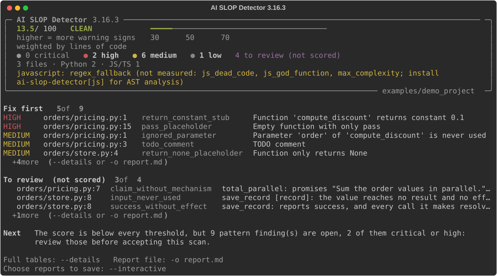
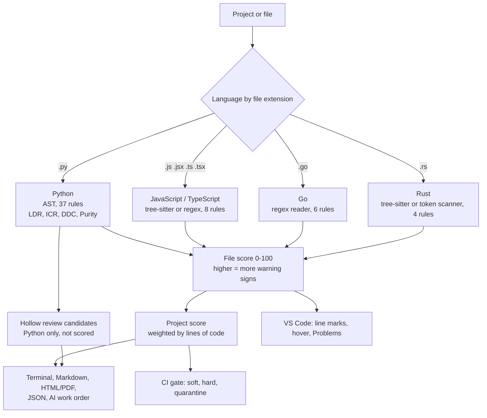
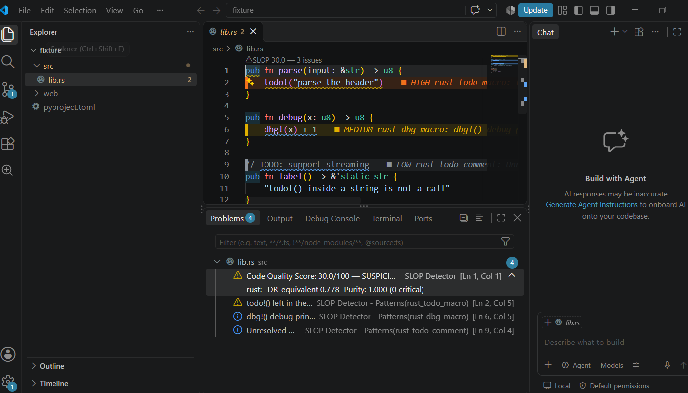
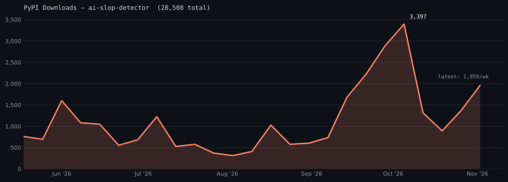

<!-- MICA:INVOKE manifest="mica.yaml" -->
<p align="center">
  
</p>

<h1 align="center">AI-SLOP Detector</h1>

<h3 align="center">Ship Code. Not Slop.</h3>

<p align="center">
Find warning signs of unfinished code in Python, JavaScript/TypeScript, Go, and Rust.<br/>
<b>No API key. No network calls. Your code never leaves your machine.</b>
</p>

<p align="center">
  <a href="https://pypi.org/project/ai-slop-detector/"></a>
  <a href="https://www.npmjs.com/package/ai-slop-detector"></a>
  <a href="https://marketplace.visualstudio.com/items?itemName=Flamehaven.vscode-slop-detector"></a>
  <a href="https://pypi.org/project/ai-slop-detector/"></a>
  <a href="https://github.com/flamehaven01/AI-SLOP-Detector/blob/main/docs/PATTERNS.md"></a>
  <a href="https://opensource.org/licenses/MIT"></a>
  <a href="https://github.com/flamehaven01/AI-SLOP-Detector/actions"></a>
</p>
<p align="center">
  <a href="https://marketplace.visualstudio.com/items?itemName=Flamehaven.vscode-slop-detector"></a>
  <a href="https://www.npmjs.com/package/ai-slop-detector"></a>
  <a href="https://pepy.tech/project/ai-slop-detector"></a>
  <a href="https://pepy.tech/project/ai-slop-detector"></a>
  <a href="https://github.com/flamehaven01/AI-SLOP-Detector/stargazers"></a>
</p>

<p align="center">
  <a href="#quick-start">Quick Start</a> ·
  <a href="#what-you-get">What You Get</a> ·
  <a href="#vs-code-extension">VS Code</a> ·
  <a href="#cicd-integration">CI/CD</a> ·
  <a href="#ai-agents">AI Agents</a> ·
  <a href="#security-considerations">Security</a> ·
  <a href="https://github.com/flamehaven01/AI-SLOP-Detector/blob/main/docs/GUIDE.md">Full Guide</a>
</p>

---

## What Is AI-SLOP Detector?

Code can look finished and still hide a stub, a swallowed error, an input
nothing reads, or a `todo!()` that panics when it is reached. Linters pass it
because it is well-formed, and AI assistants produce a lot of it.

AI-SLOP Detector is a static analyzer for that gap. It reads your code without
running it, reports each spot with the **file, the line, the rule and a fix**,
and gives every file a 0-100 score (higher = more warning signs). It does not
tell whether a person or an AI wrote the code; it reports what is in the code.

- **55 rules** across Python (37), JavaScript/TypeScript (8), Go (6) and Rust (4)
- **Deterministic**: the same input gives byte-identical JSON
- **Local only**: no API key, no model download, no network call during a scan
- **Everywhere you work**: terminal, VS Code, CI gates, pre-commit, AI agents (MCP)

## Quick Start

<a id="60-second-first-run"></a>**60-second first run** ([more in the guide](https://github.com/flamehaven01/AI-SLOP-Detector/blob/main/docs/GUIDE.md#60-second-first-run)):

```bash
pip install ai-slop-detector
slop-detector --project .
```

No configuration is needed. Then:

| Next | Command |
|---|---|
| One file | `slop-detector path/to/file.py` |
| Every report in one folder (Markdown, HTML, PDF with an installed Chrome or Edge, AI report and work order, JSON) | `slop-detector --project . --report-dir slop-report` |
| JSON for scripts (UTF-8, safe on Windows PowerShell) | `slop-detector --project . --json --output slop.json` |
| Fail a CI build | `slop-detector --project . --ci-mode hard --ci-report` |
| No install | `uvx ai-slop-detector --project .` or `npx ai-slop-detector --project .` |

Every command and option: [docs/GUIDE.md](https://github.com/flamehaven01/AI-SLOP-Detector/blob/main/docs/GUIDE.md#all-commands).

## What You Get

**The terminal screen** (`slop-detector --project examples/demo_project`):
the score and its band, the findings by severity, the first findings with the
rule and the reason, and what to do next.

<p align="center">
  
</p>

`--details` prints the full metric tables, `--quiet` one line.

**The HTML report** (`-o report.html`; `-o report.pdf` prints the same page):
every finding with its fix and evidence, and the review candidates apart from
the score.

<p align="center">
  
</p>

**Outputs for AI agents**, made to be acted on, not read:

| Output | What it is |
|---|---|
| `--format ai-md` (AI work order) | Markdown for an agent: the rules it must follow, a VERIFY question per rule, every file bound to the SHA-256 of the bytes scanned, one block per item. It is read back before it is written and refuses when an item is missing or doubled. |
| `--format ai` (AI report) | One JSON object per line: each finding with its location, rule, fix and evidence. |
| `--json` | The full result, including `scan_coverage` (what was measured and how) and `next_steps`. |

**Why the AI work order is different.** A list of warnings invites an agent
to make each one disappear. The work order is a contract instead:

- **Bound to the bytes.** Every item names the SHA-256 of the file the scan
  read. If the file changed since, the item is void: the agent must hold it
  and re-scan, not repair from a stale document.
- **Fixes that only hide a finding are forbidden.** No suppression comment,
  no threshold or weight change, no deleting or renaming the function to
  make the item vanish.
- **One question per rule, and REJECT is a valid answer.** The agent checks
  the code against the rule's VERIFY question, then answers ACK and fixes,
  or REJECT with the evidence the detector could not see. That is the
  false-alarm channel.
- **Proved by a re-scan.** An item counts as fixed only when a re-scan with
  the same configuration no longer finds it, no new item appears and the
  project's tests pass.
- **One response line per item**, so a reviewer can check every claim.

An excerpt of the real work order for `examples/demo_project`
(`slop-detector --project examples/demo_project --format ai-md`; `...`
marks lines left out):

````text
# AI-SLOP WORK ORDER
target: demo_project | files 3 | score 13.5 CLEAN (pattern channel only)
items: 13 | work order 13 | backlog 0
...
## HARD-STOP [NORM]
HS-01 the file's SHA-256 differs from source_sha256 -> HOLD the item
HS-03 the fix needs a FORBID change -> stop, REPORT HOLD
HS-04 the fix changes a public signature, a return type or code outside the item's span -> stop, needs a decision (D-*)
...
## FORBID [NORM]
- a suppression comment or a noqa / pragma marker
- a threshold, weight or config change
- deleting or renaming the function to make the item vanish
...
#### W01 F7843b06ebed5 FINDING return_constant_stub high
at [FACT]: orders/pricing.py:1
bound_to [FACT]: B01 (the file is the content the scan analyzed)
evidence [FACT]: Function 'compute_discount' returns constant 0.1 - likely stub; also breaks its docstring: promises "Compute the discount for the order." (computed_result); every return is a literal (0.1)
verify [NORM]: the body needs a value computed from the inputs, or an open call that could compute it; found: every return is a literal. ACK: implement the mechanism, or change the docstring to what the function does; REJECT: name the mechanism the detector missed (file:line)
span [FACT]: orders/pricing.py:1-4 `compute_discount`
```python
1| def compute_discount(order):
2|     """Compute the discount for the order."""
3|     # TODO: use the customer's tier
4|     return 0.1
```
...
## RESPONSE-FORM [FORMAT]
`<id> ACK|REJECT|HOLD verify=PASS|FAIL fix=<one line|NOT-APPLICABLE: why> prove=PASS|FAIL|NOT-MEASURED evidence=<file:line or test name>`
````

Details: [docs/REPORTS.md](https://github.com/flamehaven01/AI-SLOP-Detector/blob/main/docs/REPORTS.md) ·
[docs/AI_WORK_ORDER.md](https://github.com/flamehaven01/AI-SLOP-Detector/blob/main/docs/AI_WORK_ORDER.md) ·
[what you get, in the guide](https://github.com/flamehaven01/AI-SLOP-Detector/blob/main/docs/GUIDE.md#what-you-get).

## Languages

| Language | Files | Read by (base install) | Optional extra (Python 3.10+) | Rules |
|---|---|---|---|---|
| Python | `.py` | Python AST | - | 37 |
| JavaScript / TypeScript | `.js` `.jsx` `.ts` `.tsx` | regex reader (god functions, dead code and complexity are not measured) | `[js]`: tree-sitter, measures all 8 | 8 |
| Go | `.go` | regex reader, measures every Go rule | `[go]` installs tree-sitter-go; the analyzer does not use it yet | 6 |
| Rust | `.rs` | token scanner, measures every Rust rule | `[rust]`: tree-sitter, same findings | 4 |

```bash
pip install "ai-slop-detector[js]"     # or [rust]; on Python 3.8/3.9 the base install reads these files
```

Rule counts come from the pattern registry in [docs/PATTERNS.md](https://github.com/flamehaven01/AI-SLOP-Detector/blob/main/docs/PATTERNS.md)
(55 rules), which a test keeps in line with the analyzers. A scan says which
reader ran for each language (`scan_coverage.analysis_modes`).

## What It Detects

| Language | Example | Rules (sample) |
|---|---|---|
| Python | a function that returns a constant where its docstring promises a computed result; a handler that turns a failure into success; a parameter nothing reads; an import of a package that does not exist | `return_constant_stub`, `failure_as_success`, `ignored_parameter`, `phantom_import` |
| JavaScript / TypeScript | `any` types, empty arrow functions, `==`, leftover `console.log` | `js_any_type`, `js_empty_arrow`, `js_double_equals`, `js_console_log` |
| Go | ignored errors, `panic()` as error handling, empty functions | `go_ignored_error`, `go_panic`, `go_empty_func` |
| Rust | `todo!()` and `unimplemented!()` outside test code, leftover `dbg!()` | `rust_todo_macro`, `rust_unimplemented_macro`, `rust_dbg_macro` |

Python files also get **hollow review candidates**: functions that report
success with no effect, inputs that reach nothing, docstring promises the body
cannot keep. They are listed for review and never change the score.

All 55 rules: [docs/PATTERNS.md](https://github.com/flamehaven01/AI-SLOP-Detector/blob/main/docs/PATTERNS.md).

## How It Works



The same input gives the same output: scoring is deterministic and needs no
model or network. Details: [docs/HOW_IT_WORKS.md](https://github.com/flamehaven01/AI-SLOP-Detector/blob/main/docs/HOW_IT_WORKS.md).

## Scoring Model

| Score | Status |
|---|---|
| < 30 | `CLEAN` |
| 30 - 50 | `SUSPICIOUS` |
| 50 - 70 | `INFLATED_SIGNAL` |
| >= 70 | `CRITICAL_DEFICIT` |

- **Higher score = more warning signs.** Each file gets a deficit score from
  0 to 100; the project score weights files by their lines of code.
- **`CLEAN` is a score band, not "no findings".** A clean project can still
  have open findings; its next steps then say how many, and how many are
  critical or high.
- **Nothing measured is not clean.** When no file could be analyzed, reports
  read `NOT EVALUATED`, and `--fail-threshold` fails.
- **Findings are leads, not verdicts.** The tool reads code statically: it
  does not run it.

How the score is computed: [the scoring model in the guide](https://github.com/flamehaven01/AI-SLOP-Detector/blob/main/docs/GUIDE.md#scoring-model) and
[docs/MATH_MODELS.md](https://github.com/flamehaven01/AI-SLOP-Detector/blob/main/docs/MATH_MODELS.md).

## VS Code Extension

Findings where you write code, for all four languages: a tint and a severity
bar on the line, the message at the end of it, a hover with the **Fix** and a
link that copies a work order for an AI agent, the Problems panel, a sidebar
of files by score, and the file score in the status bar. It runs the same
local backend; nothing is sent anywhere.

<p align="center">
  
</p>

[Install from the Marketplace](https://marketplace.visualstudio.com/items?itemName=Flamehaven.vscode-slop-detector) ·
[extension guide](https://github.com/flamehaven01/AI-SLOP-Detector/blob/main/vscode-extension/README.md)

## CI/CD Integration

```yaml
# GitHub Actions
- name: AI-SLOP Gate
  run: |
    pip install ai-slop-detector
    slop-detector --project . --ci-mode hard --ci-report
```

| Mode | What it does |
|---|---|
| `--ci-mode soft` | Reports only, never fails the build |
| `--ci-mode hard` | Fails on a deficit score >= 70, 3 or more critical patterns, inflation >= 1.5 or DDC < 0.5 (inflation and DDC are Python metrics) |
| `--ci-mode quarantine` | Escalates a file after 3 violations |

The gate judges every analyzed file: Python, JS/TS, Go and Rust. pre-commit
hooks (`slop-detector`, `slop-detector-warn`, `slop-detector-patterns`) and
more: [CI/CD in the guide](https://github.com/flamehaven01/AI-SLOP-Detector/blob/main/docs/GUIDE.md#cicd-integration) ·
[docs/CI_CD.md](https://github.com/flamehaven01/AI-SLOP-Detector/blob/main/docs/CI_CD.md).

## AI Agents

| Surface | How |
|---|---|
| **MCP server** | `slop-detector mcp` (or `npx ai-slop-detector mcp`) for Claude Code and other MCP clients |
| **Claude Code skill** | `cp -r claude-skills/slop-detector ~/.claude/skills/`: a review loop of `review`, `pulse`, `sweep` with JSON output |
| **AI work order** | `--format ai-md`, bound to the SHA-256 of each scanned file (see [What You Get](#what-you-get)) |
| **REST** | A local FastAPI server (`[api]` extra) that binds `127.0.0.1` |
| **Node** | `npx ai-slop-detector` runs the same Python backend; typed results at `ai-slop-detector/types` |

**With Claude Code**, the skill turns the scanner into a review loop the
agent follows instead of a list it reacts to:

```text
generate/edit -> review -> inspect evidence -> apply bounded fixes -> pulse/sweep -> human handoff
```

`review` judges changed code (what the change introduced versus what was
already there, and whether the build should fail), `pulse` summarizes the
project's health and the order to repair in, and `sweep <family>` plans one
cleanup (dead code, duplicates, unused dependencies, stale suppressions,
boundary violations). The skill tells the agent which fixes are safe to make
on its own and when to stop and hand over to a person, so the scanner's
output is not read as permission for blind edits.

```bash
cp -r claude-skills/slop-detector ~/.claude/skills/
pip install ai-slop-detector
```

**An agent working on this repository** starts from its memory:
[`mica.yaml`](https://github.com/flamehaven01/AI-SLOP-Detector/blob/main/mica.yaml)
selects the decisions a change must not undo, each with the test or the
explicit verification procedure that holds it, and the procedure for
verifying and releasing. Load it with the context
emitter of [MICA](https://github.com/flamehaven01/Flamehaven-MICA)
(`python <MICA_ROOT>/tools/mica_runtime.py . --format context`).

Details: [Claude Code integration](https://github.com/flamehaven01/AI-SLOP-Detector/blob/main/docs/GUIDE.md#claude-code-integration) ·
[docs/CLAUDE_CODE_SKILL.md](https://github.com/flamehaven01/AI-SLOP-Detector/blob/main/docs/CLAUDE_CODE_SKILL.md) ·
[docs/API.md](https://github.com/flamehaven01/AI-SLOP-Detector/blob/main/docs/API.md).

## Local Calibration

Every scan is recorded locally (`~/.slop-detector/history.db`) with what
measured it, for all four languages. `slop-detector . --self-calibrate`
reports how the weights would change from the comparable runs of one
project. It is advisory: it never writes weights; you change them in
`.slopconfig.yaml` if you agree.

The report shows what its evidence is worth, rule by rule: a warning that
went away on changed code (its correctness is not checked), a warning left
unchanged, a plain suppression, and a false positive you declared with
`# slop-disable-next-line <rule> fp: <reason>`. None of these is taken as
proof. An `ok` recommendation means the best candidate was at least 0.10
ahead of the next one on this project's own history; it is not a validated
accuracy gain.
`--self-calibrate --json` prints the same report as data and writes nothing.

`slop-detector --init` detects the project's domain and sets that domain's
pattern thresholds, printing every change.
[Local calibration in the guide](https://github.com/flamehaven01/AI-SLOP-Detector/blob/main/docs/GUIDE.md#local-calibration) ·
[docs/SELF_CALIBRATION.md](https://github.com/flamehaven01/AI-SLOP-Detector/blob/main/docs/SELF_CALIBRATION.md).

## Security Considerations

- **No network during a scan.** A test runs a full project scan with every
  socket connection refused and requires that none was attempted.
- **`--read-only`** writes nothing to the project or the home directory.
- **`history.db`** lives in your home directory, outside every repository.
- **`.slopconfig.yaml`** lists which functions are exempt from complexity
  rules, so it maps the weak spots of a codebase; `--init` adds it to
  `.gitignore` (remove that line to share it with your team).
- **Reports describe your code.** Every report names file paths, function
  names and docstring text, and the AI work order (auditor mode) quotes code
  lines: share them as you would the code.

More: [security considerations in the guide](https://github.com/flamehaven01/AI-SLOP-Detector/blob/main/docs/GUIDE.md#security-considerations) ·
[SECURITY.md](https://github.com/flamehaven01/AI-SLOP-Detector/blob/main/SECURITY.md).

---

## Why Not Just Use a Linter?

Ruff, pylint, ESLint, and SonarQube primarily check syntax, style, and general static-quality rules. They'll happily pass code that follows every rule and still does nothing — which is exactly what AI assistants tend to produce. This tool checks the other half: **does the code contain structural evidence for what it and its docs claim?** Structural evidence is not proof that a claim is true; the tool does not run your code.

| Can it catch... | ruff / pylint / SonarQube | AI-SLOP Detector |
|---|---|---|
| Style, formatting, syntax | Yes | No (not its job) |
| An empty function with a real-looking body or fake return | No | Yes |
| A module imported but never actually used downstream | Partial (unused-import) | Yes (usage ratio) |
| A handler or pipeline that's defined but never wired in | No | Yes |
| Docs or comments that oversell what the code does | No | Yes |
| Copy-pasted duplicate functions across files | Partial | Partial (exact duplicates) |
| Runs offline, no API key, deterministic core score | Yes | Yes |

Use a linter for correctness-of-form. Use this for "is this code real, or just plausible-looking." The two are complementary — run both.

## When NOT to Use This

- **You want style or formatting enforcement** — use ruff / black / ESLint. This tool ignores style on purpose.
- **You need a runtime correctness guarantee** — a low score means cleaner structure, not that the code works. Keep your tests.
- **Your code isn't Python, JS/TS, Go or Rust** — other languages aren't analyzed yet.
- **You expect thresholds tuned to your repository** — weights are the defaults or the values in your `.slopconfig.yaml`; nothing tunes them automatically. Treat findings as leads, not verdicts.

## How Results Are Checked

| | |
|---|---|
| **Deterministic** | The same input gives byte-identical JSON across cache, hash seed, Rust helper and working directory; `--read-only` writes nothing to the project or the home directory. |
| **Says when it measured nothing** | Every project result carries `measurement_state` (`COMPLETE`, `PARTIAL`, `NO_MEASUREMENT`) and `score_valid`. When nothing was measured, human reports read `NOT EVALUATED` instead of a clean verdict, and a scan whose files all failed to analyze fails `--fail-threshold`. |
| **Its own tests are tested** | More than 1,900 tests run in CI on Python 3.8 to 3.12. Behavior changes are checked against deliberately broken copies of the code (mutation testing): in v3.14.0, 133 of 133 breakages of the item identity, binding, work-order and docstring-promise rules were caught; in v3.15.0, 24 of 24 breakages of the work-order families, file table, read-back check and budget (v3.12.0: 21 of 21). |
| **Rules state their reasons** | Each rule ships with tests that name the code shape it reports and the shapes it leaves alone; the [CHANGELOG](https://github.com/flamehaven01/AI-SLOP-Detector/blob/main/CHANGELOG.md) records every behavior change. |

---

## Release Highlights

**v3.16.3**: a file with an `fp:` declaration stays in every scan; from the
second scan on it failed to load from the analysis cache (a single-file scan
failed, a project scan left the file out). Scoring is unchanged.

**v3.16.2**: self-calibration shows each rule's evidence (a resolved
warning, an unchanged warning, a suppression, a declared false positive with
`fp:`), history covers all four languages and stores only measured values,
and `--self-calibrate --json` prints the report; scoring is unchanged (a
suppression comment with words after `fp:` can show findings again).

**v3.16.1**: Rust files are analyzed (`todo!()`, `unimplemented!()`, `dbg!()`,
TODO comments) and judged by the CI gate like the other languages; Go and
JS/TS regex readers no longer report text inside strings or comments; the CI
report states its verdict and lists files it could not analyze. Every
release: [docs/RELEASE_NOTES.md](https://github.com/flamehaven01/AI-SLOP-Detector/blob/main/docs/RELEASE_NOTES.md#release-highlights-one-line-per-version) ·
[CHANGELOG.md](https://github.com/flamehaven01/AI-SLOP-Detector/blob/main/CHANGELOG.md).

## Document Map

The full guide holds everything this page leaves out:
[docs/GUIDE.md](https://github.com/flamehaven01/AI-SLOP-Detector/blob/main/docs/GUIDE.md).

| Topic | Where |
|---|---|
| Every command, the npm wrapper | [All commands](https://github.com/flamehaven01/AI-SLOP-Detector/blob/main/docs/GUIDE.md#all-commands) · [CLI usage](https://github.com/flamehaven01/AI-SLOP-Detector/blob/main/docs/CLI_USAGE.md) |
| Reports | [Reports](https://github.com/flamehaven01/AI-SLOP-Detector/blob/main/docs/REPORTS.md) · [AI work order](https://github.com/flamehaven01/AI-SLOP-Detector/blob/main/docs/AI_WORK_ORDER.md) |
| Rules and analyzers | [Patterns](https://github.com/flamehaven01/AI-SLOP-Detector/blob/main/docs/PATTERNS.md) · [What it detects](https://github.com/flamehaven01/AI-SLOP-Detector/blob/main/docs/GUIDE.md#what-it-detects) · [Adding a language](https://github.com/flamehaven01/AI-SLOP-Detector/blob/main/docs/ADDING_A_LANGUAGE.md) |
| Scoring and metrics | [How it works](https://github.com/flamehaven01/AI-SLOP-Detector/blob/main/docs/HOW_IT_WORKS.md) · [Math models](https://github.com/flamehaven01/AI-SLOP-Detector/blob/main/docs/MATH_MODELS.md) · [Validation](https://github.com/flamehaven01/AI-SLOP-Detector/blob/main/docs/VALIDATION.md) |
| Configuration | [Configuration guide](https://github.com/flamehaven01/AI-SLOP-Detector/blob/main/docs/CONFIGURATION.md) · [Examples](https://github.com/flamehaven01/AI-SLOP-Detector/blob/main/docs/CONFIG_EXAMPLES.md) · [History tracking](https://github.com/flamehaven01/AI-SLOP-Detector/blob/main/docs/HISTORY_TRACKING.md) |
| Architecture | [Architecture](https://github.com/flamehaven01/AI-SLOP-Detector/blob/main/docs/ARCHITECTURE.md) · [Governance](https://github.com/flamehaven01/AI-SLOP-Detector/blob/main/docs/GOVERNANCE.md) · [Agent workflow](https://github.com/flamehaven01/AI-SLOP-Detector/blob/main/docs/AGENT_WORKFLOW.md) |
| Releases | [Release notes](https://github.com/flamehaven01/AI-SLOP-Detector/blob/main/docs/RELEASE_NOTES.md) · [Changelog](https://github.com/flamehaven01/AI-SLOP-Detector/blob/main/CHANGELOG.md) · [Roadmap](https://github.com/flamehaven01/AI-SLOP-Detector/blob/main/ROADMAP.md) |

More sections of the guide (old links to this page land here):

- <a id="verification-path"></a>[Verification path](https://github.com/flamehaven01/AI-SLOP-Detector/blob/main/docs/GUIDE.md#verification-path): how to check a result yourself
- <a id="scope-and-boundaries"></a>[Scope and boundaries](https://github.com/flamehaven01/AI-SLOP-Detector/blob/main/docs/GUIDE.md#scope-and-boundaries): what it does not measure
- <a id="key-features"></a>[Key features](https://github.com/flamehaven01/AI-SLOP-Detector/blob/main/docs/GUIDE.md#key-features): `--init`, JS/TS, structural coherence, source held in memory
- <a id="claude-code-integration"></a>[Claude Code integration](https://github.com/flamehaven01/AI-SLOP-Detector/blob/main/docs/GUIDE.md#claude-code-integration): the review, pulse and sweep loop
- <a id="configuration"></a>[Configuration](https://github.com/flamehaven01/AI-SLOP-Detector/blob/main/docs/GUIDE.md#configuration): `.slopconfig.yaml`, domains, ignores
- <a id="inline-suppression"></a>[Inline suppression](https://github.com/flamehaven01/AI-SLOP-Detector/blob/main/docs/GUIDE.md#inline-suppression): mute a rule on a line or a block; it stays in the suppression ledger
- <a id="repeated-run-cache"></a>[Repeated-run cache](https://github.com/flamehaven01/AI-SLOP-Detector/blob/main/docs/GUIDE.md#repeated-run-cache): an unchanged Python file reuses its earlier result
- <a id="priority-hotspots"></a>[Priority hotspots](https://github.com/flamehaven01/AI-SLOP-Detector/blob/main/docs/GUIDE.md#priority-hotspots): which Python files to fix first (score, git churn, coverage)
- <a id="agent-surface"></a>[Agent surface](https://github.com/flamehaven01/AI-SLOP-Detector/blob/main/docs/GUIDE.md#agent-surface): the REST routes for agents

## Development

```bash
git clone https://github.com/flamehaven01/AI-SLOP-Detector.git
cd AI-SLOP-Detector
pip install -e ".[dev]"
pytest tests/
```

[Development guide](https://github.com/flamehaven01/AI-SLOP-Detector/blob/main/docs/DEVELOPMENT.md) ·
[Contributing](https://github.com/flamehaven01/AI-SLOP-Detector/blob/main/CONTRIBUTING.md) ·
[development in the guide](https://github.com/flamehaven01/AI-SLOP-Detector/blob/main/docs/GUIDE.md#development).

## Download Stats

<p align="center">
  
</p>

*Chart updated weekly via [GitHub Actions](https://github.com/flamehaven01/AI-SLOP-Detector/blob/main/.github/workflows/download-chart.yml). Monthly installs: [pypistats.org](https://pypistats.org/packages/ai-slop-detector) (mirrors excluded). Total: [pepy.tech](https://pepy.tech/project/ai-slop-detector) (incl. mirrors)*

## License

MIT — see [LICENSE](https://github.com/flamehaven01/AI-SLOP-Detector/blob/main/LICENSE).

---

<p align="center">
  <b>Flamehaven Labs</b> •
  <a href="https://github.com/flamehaven01/AI-SLOP-Detector/issues">Issues</a> •
  <a href="https://github.com/flamehaven01/AI-SLOP-Detector/discussions">Discussions</a> •
  <a href="https://github.com/flamehaven01/AI-SLOP-Detector/tree/main/docs">Docs</a>
</p>
