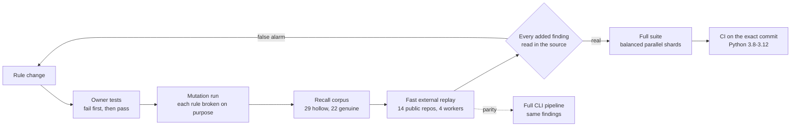

# Development Guide

## Setup

```bash
git clone https://github.com/flamehaven01/AI-SLOP-Detector.git
cd AI-SLOP-Detector
python -m venv .venv
# Windows: .venv\Scripts\activate
# POSIX: source .venv/bin/activate
pip install -e ".[dev]"
slop-detector --version
```

Optional language and API extras are declared in `pyproject.toml`. Install only
the extras required by the test or integration being changed.

## Current Module Boundaries

```text
src/slop_detector/
  core.py                 compatibility facade and orchestration
  core_scoring.py         deterministic file-score helpers
  core_topology.py        DCF and structural coherence helpers
  core_project.py         discovery, coverage, aggregation
  cli*.py                 parsers, routing, analysis, output, history, init
  operations*.py          audit, health, cleanup, architecture helpers
  metrics/                LDR, inflation, dependency and related signals
  patterns/               registry and advanced pattern detectors
  analysis/               cross-file import graph, structure and connection evidence
  autofix/                line-oriented patchers (`--fix`)
  gate/                   legacy SlopGate (`--gate`)
  governance/             governance session and `verify-governance`
  ml/                     optional ML scoring and self-calibration
  auth/                   experimental, not wired into the core
  config/                 bundled data (known dependency names)
  languages/              JS/TS and Go adapters
  mcp/                    stdio tool surface
  api/                    optional local FastAPI surface
tests/                    regression and contract tests
npm-wrapper/              Node transport over the Python CLI
vscode-extension/         editor integration
```

Keep pure calculation in the focused `core_*` modules. Keep `core.py` facades
when an existing integration or test patches that seam. Do not duplicate score
or result-contract logic in the CLI, npm wrapper, or editor extension.

## Verification

Run focused tests while changing a module, then the declared local suite before
asking for review:

```bash
python -m pytest tests/test_core.py -q
python -m pytest -q --no-cov
python -m black --check src tests
python -m ruff check src tests
python -m mypy src
```

For a detector change, add a regression fixture and a negative control. For a
public contract change, test the CLI JSON, npm type surface, or MCP/API model
that consumes it. A passing local suite does not prove deployment behavior,
external validity, or release readiness.

### How a detection rule is verified



1. **Owner tests** for the new or changed rule fail before the change and pass after it,
   with negative controls for every exemption.
2. **Mutation run**: each condition of the rule is broken in turn; a test must fail for each.
3. **Recall corpus** (`benchmarks/recall`): `python benchmarks/recall/measure.py` reports hollow
   functions caught per class and genuine functions flagged. The corpus is written by the
   maintainers; the external replay is the check against fitting rules to it.
4. **Fast external replay** (`scripts/dev/fast_replay.py`): runs only the selected patterns
   through the product's own discovery, config resolution and `analyze_file`, repositories in
   parallel, and records git HEAD, dirty files, coverage state and each finding's file
   SHA-256. `parity` mode compares it with the full CLI pipeline on
   `(file, line, pattern, message)`.
5. **Read every added finding** in the source; narrow the rule where it is wrong, and replay.
6. **Full suite** in balanced parallel shards (`scripts/dev/parallel_tests.py`), then CI on the
   exact commit.

```bash
python -P scripts/dev/parallel_tests.py --workers 4
python -P scripts/dev/fast_replay.py run    --src src --repos <dir> --patterns ignored_parameter --out new.json <repo> ...
python -P scripts/dev/fast_replay.py parity --src src --repos <dir> --patterns ignored_parameter <repo> ...
python -P scripts/dev/fast_replay.py diff   old.json new.json
```

Measured on one Windows desktop with 8 logical cores (2026-10-26):

| Step | Before | With the tools |
|---|---:|---:|
| Full suite (1,678 tests) | 270 s on one core | 77-87 s (three consecutive runs), 4 shards balanced on recorded per-file time |
| External replay, 14 repositories | ~10 min per full-pipeline pass | 128-181 s, 14/14 identical to the full pipeline |

The parallel runner assigns test files longest-first to the least-loaded worker using the
seconds recorded by its previous run (`.pytest_durations.json`, git-ignored); the first
run, with nothing recorded, is unbalanced. Two rules keep shards independent, each found by
a test that failed only in parallel:

- each worker gets its own `--basetemp`: pytest prunes old numbered temp directories under
  a shared root, which deleted another worker's `tmp_path` while it was in use;
- workers keep the real HOME: git refuses a fresh one ("dubious ownership"); tests that need
  an isolated HOME set their own.

Selecting tests by the source files a change touches is the next step and is not built yet.

## Documentation Rules

- Update the current behavior guides when CLI, config, JSON, or integration
  contracts change.
- Preserve `CHANGELOG.md` and `RELEASE_NOTES.md` as historical records.
- Keep `LEDA_CALIBRATION.md` and `LEDA_TURBO_PROTOCOL_DOGFOODING.md` marked as
  legacy material rather than using them for current behavior.
- State limits as clearly as capabilities. Do not convert dogfooding or local
  tests into accuracy, performance, security, or compliance claims.

## Commits And Releases

Stage only the intended paths:

```bash
git add <changed-paths>
git commit -m "type(scope): concise change summary"
```

Keep unreleased changes in `CHANGELOG.md` until a user-facing release is ready.
For a release, update the package version surfaces, validate the declared
release profile, create an annotated tag, and create the GitHub Release. The
release workflow owns publication; do not upload packages manually as a normal
development step.

## Review Checklist

- The diff preserves public and patch seams or deliberately version them.
- Targeted tests cover the changed behavior and an adverse case where relevant.
- Formatter, linter, and type checks pass for changed Python code.
- Documentation describes the observed implementation, not a roadmap.
- No secrets, local databases, build products, or generated reports are staged.

See [CLI_USAGE.md](CLI_USAGE.md), [CONFIGURATION.md](CONFIGURATION.md),
[VALIDATION.md](VALIDATION.md), and [GOVERNANCE.md](GOVERNANCE.md).
