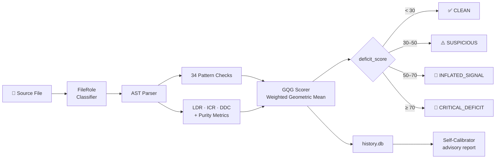
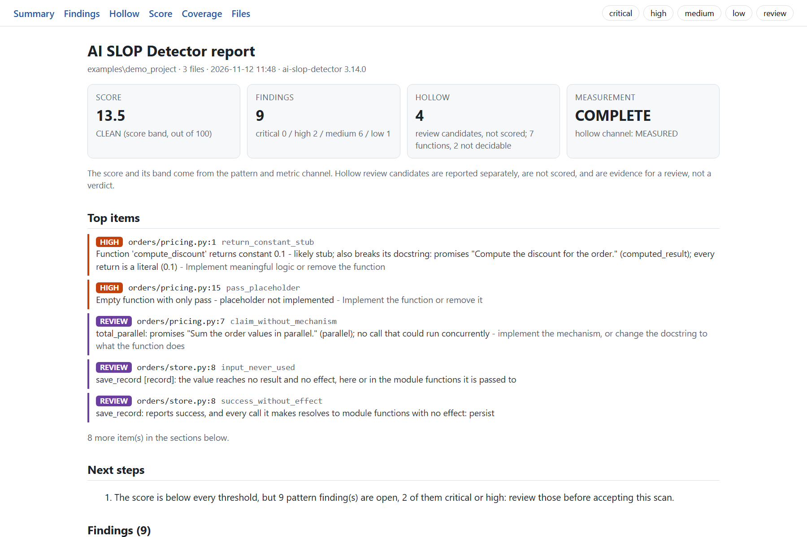

# AI-SLOP Detector - Full Guide

The [README](../README.md) is the short introduction. This page holds the
details it links to: every command, the report surfaces, the scoring model,
the per-language analyzers, configuration, CI and the agent interfaces.
The sections were moved here from the README in 3.16.1; their text is unchanged
except for link paths, three headings, the install lines (no version pin), the
pre-commit `rev` (the current release), the note on the historical VS Code appendix,
and one passage about a validation command this package does not ship, which was dropped.
The VS Code extension has its own guide: [the extension guide](../vscode-extension/README.md).

## What Is AI-SLOP Detector?

AI-SLOP Detector is an **evidence-based static analyzer** that targets a defect class common in AI-assisted code: structurally plausible code that is functionally empty, disconnected, or misleading. It does not tell whether code was written by an AI; it reports static signals in the code itself.

General linters flag style and convention. This tool flags structural risk.

- **55 checks across Python, JS/TS, Go and Rust** (the [pattern registry](PATTERNS.md)) — empty stubs, imports that don't resolve, unreachable code, copy-paste clones, and buzzword-padded docs
- **One 0–100 risk score per file** — four measurements are combined so one bad dimension can't be hidden behind good ones (weighted geometric mean of logic density, jargon inflation, dependency use, and critical severity)
- **Keeps local history** — every scan is recorded locally with what measured it (detector version, configuration, project root); `--self-calibrate` reports what the comparable runs of your project suggest for the weights. The report is advisory: weights change only when you edit `.slopconfig.yaml`.
- **Tells real changes from noise** — uses your commit history so a score drifting a point or two isn't mistaken for a real regression
- **Knows your project type** — `--init` detects the domain (web API, data/ML, numerical, CLI, library, bio, finance, or general; `general` when the evidence is weak) and sets that domain's pattern thresholds, printing every change; weights stay the defaults; override with `--domain`
- **Python first; JS/TS, Go and Rust too** — `.js`/`.ts`, `.go` and `.rs` files are scanned by the base install; the `[js]` and `[rust]` extras add tree-sitter parsing (Python 3.10+), Go is read by its regex reader either way
- **Drops into CI** — soft / hard / quarantine gates, GitHub Actions ready
- **VS Code extension** — inline warnings as you type, score in the status bar

---

## How It Works (Python file pipeline)



Every file goes through **four** independent measurement axes (LDR, ICR, DDC,
Purity) **and** 37 Python rules: 34 pattern checks plus 3 dependency-declaration
checks (55 rules in all languages, [PATTERNS.md](PATTERNS.md)). Results are combined via a **weighted
geometric mean** — a near-zero in any single dimension pulls the overall score
down regardless of other dimensions. Every scan is recorded to local history; `--self-calibrate`
turns that history into an advisory weight report and never writes weights.

Full specification: [docs/HOW_IT_WORKS.md](HOW_IT_WORKS.md) · [docs/MATH_MODELS.md](MATH_MODELS.md)
Agent usage: [docs/AGENT_WORKFLOW.md](AGENT_WORKFLOW.md)

---

## 60-Second First Run

No project-side config needed. Run it against any folder of Python:

```bash
pip install ai-slop-detector
slop-detector --project . --json --output slop.json
python -c "import json; d=json.load(open('slop.json',encoding='utf-8')); print(d['overall_status'], d['weighted_deficit_score'])"
```

Expected output for a healthy project: `clean 0.0` to `clean 30.0`. `clean`
describes the weighted deficit band only; inspect `finding_summary`,
`scan_coverage`, and `ml_scoring` before treating it as a complete project
assessment. Modules that hold only static data (`literal_data_module`) are
analyzed but carry no line weight in the weighted score;
`scan_coverage.aggregation_exclusions` lists them. The `--output`
form writes UTF-8 (no BOM) directly to disk, so it is safe under Windows
PowerShell — prefer it to `> slop.json` redirection.

---

## All Commands

```bash
pip install ai-slop-detector

slop-detector scan .                        # canonical analysis entry
slop-detector review . --json              # canonical changed-code review
slop-detector pulse . --json               # canonical repo health view
slop-detector sweep dead-code . --json     # canonical cleanup family

# legacy / compatible surface
slop-detector --init                       # bootstrap baseline .slopconfig.yaml + .gitignore
slop-detector --init --adaptive-init --init-preview
slop-detector --init --adaptive-init --apply-init-suggestions
slop-detector mycode.py                    # single file
slop-detector --project ./src             # entire project
slop-detector --project . --include-tests # include only default-excluded test files
slop-detector --project . --json --output slop.json   # machine-readable output (Windows-safe)
slop-detector --project . --ci-mode hard --ci-report  # CI gate

# Optional extras, Python 3.10+ (tree-sitter needs it). On 3.8/3.9 the [js] and [go]
# commands fail to resolve and install nothing: install the base package, which
# reads those files with its fallback readers.
pip install "ai-slop-detector[js]"       # JS/TS tree-sitter analysis
pip install "ai-slop-detector[go]"       # installs tree-sitter-go; the Go analyzer does not use it yet
pip install "ai-slop-detector[rust]"     # Rust tree-sitter analysis (installs nothing on 3.8/3.9)

# npm wrapper (delegates to the Python CLI). With no Python backend installed
# it runs the PyPI release of the same version through uvx or pipx.
npx ai-slop-detector --project .
npm install --save-dev ai-slop-detector

npx ai-slop-detector scan .
npx ai-slop-detector review . --format json
npx ai-slop-detector pulse . --format json
npx ai-slop-detector sweep dead-code . --format json
npx ai-slop-detector mcp

# Typed output contract
import type { ReviewOutput, ScanOutput } from "ai-slop-detector/types"

# Programmatic Node API
import { scanProject, reviewChanges, computeHealth, runCleanupFamily } from "ai-slop-detector"

# Local impact story
slop-detector impact enable .
slop-detector impact .

# Telemetry controls (default: off)
slop-detector telemetry status
slop-detector telemetry inspect --example

# Local wrapper development
cd npm-wrapper
node ./bin/ai-slop-detector.js --version

# No install required
uvx ai-slop-detector mycode.py
npx ai-slop-detector mycode.py   # same, through the npm wrapper
```

The npm surface is intentionally thin:

- it does **not** reimplement analysis logic
- it delegates into the Python CLI/runtime
- it exists for Node-first teams that want `npx`-style entry without changing
  product semantics; it is published on npm as `ai-slop-detector` with the
  same version as the PyPI release
- it discovers a backend in this order: `AI_SLOP_DETECTOR_EXECUTABLE` ->
  active `VIRTUAL_ENV` -> PATH executables -> `python -m slop_detector.cli` ->
  `uvx` / `pipx` running the PyPI release of the wrapper's own version (uv
  can also fetch Python), so `npx` works without a Python install when uv or
  pipx is present
- it ships version-pinned TypeScript interfaces at `ai-slop-detector/types`
- it exports a small async Node API for `scanProject`, `reviewChanges`,
  `computeHealth`, and `runCleanupFamily`

> **Windows / PowerShell tip:** PowerShell `>` redirection writes UTF-16 LE
> or UTF-8 with BOM by default, which breaks `json.load(..., encoding='utf-8')`.
> Use `--output <path>` instead — it writes UTF-8 bytes (no BOM) directly,
> skipping the shell.

---

## What You Get

One scan gives a person one screen of what matters and an AI agent a work
order it can verify and act on. Everything below was produced from
[`examples/demo_project`](../examples/demo_project) with:

```bash
slop-detector --project examples/demo_project --report-dir demo-report
```

**HTML report** (`-o report.html`; `-o report.pdf` prints the same page to A4
with an installed Chrome, Edge or Chromium). Pattern findings are scored;
hollow review candidates (code that reports work it does not do, inputs that
reach nothing, docstring promises the body cannot keep) are listed separately
and never move the score.

<p align="center">
  
</p>

**Terminal** (the default screen; `--details` prints the full metric tables,
`--quiet` one line):

```text
╭─ AI SLOP Detector 3.16.3 ────────────────────────────────────────────────────────────────────╮
│  13.5 / 100  CLEAN             ━━━━━───────────────────────────────────                      │
│  higher = more warning signs              30      50      70                                 │
│  weighted by lines of code                                                                   │
│  ● 0 critical   ● 2 high   ● 6 medium   ● 1 low   4 to review (not scored)                   │
│  3 files · Python 2 · JS/TS 1 · 0.9 s                                                        │
╰────────────────────────────────────────────────────────────────────── examples/demo_project ─╯

 Fix first  5 of 9
 HIGH    orders/pricing.py:1   return_constant_stub     Function 'compute_discount' returns con…
 HIGH    orders/pricing.py:15  pass_placeholder         Empty function with only pass
 MEDIUM  orders/pricing.py:1   ignored_parameter        Parameter 'order' of 'compute_discount'…
 MEDIUM  orders/pricing.py:3   todo_comment             TODO comment
 MEDIUM  orders/store.py:4     return_none_placeholder  Function only returns None
  +4 more (--details or -o report.md)

 To review (not scored)  3 of 4
   orders/pricing.py:7  claim_without_mechanism  total_parallel: promises "Sum the order values…
   orders/store.py:8    input_never_used         save_record [record]: the value reaches no res…
   orders/store.py:8    success_without_effect   save_record: reports success, and every call i…
  +1 more (--details or -o report.md)

 Next  The score is below every threshold, but 9 pattern finding(s) are open, 2 of them critical
       or high: review those before accepting this scan.

 Full tables: --details   Report file: -o report.md
 Choose reports to save: --interactive
```

**AI work order** (`--format ai-md`, also written as `ai-report.md` by
`--report-dir`): a Markdown document for an agent with the rules it must
follow, a VERIFY question per rule, a FILES table that binds each file to the
SHA-256 of the bytes the scan analyzed, and one block per item, grouped into
families that share a rule, fix and evidence shape. Before it is written, the
document is read back: an item that is missing, doubled or shown with a field
that differs from its record makes it refuse. The auditor mode (default) shows the
code and grants no right to change it; `--ai-mode agent` copies no code and
holds until its preconditions (repository readable, hashes match, operator
approval, a test profile) pass. `--ai-token-budget N` fits it in an estimated
budget. Details: [docs/AI_WORK_ORDER.md](AI_WORK_ORDER.md).

```

---

## Verification Path

Use the same verification surface the repository exposes in CI:

```bash
pip install -e ".[dev]"
python -m pytest -q
ruff check src tests
python -m build
```

Governance verification is a separate enforcement gate:

```bash
slop-detector verify-governance <artifact>
```

See [docs/GOVERNANCE.md](GOVERNANCE.md) for the artifact contract and
policy checks.

Operational review commands live on the same CLI entry point:

```bash
slop-detector review . --json
slop-detector pulse . --json
slop-detector sweep dead-code . --json
slop-detector sweep dupes . --json
slop-detector sweep unused-deps . --json
slop-detector sweep boundary-violations . --json
slop-detector watch . --follow
slop-detector explain dead-code
```

Legacy command forms such as `audit`, `health`, and direct cleanup-family names
remain supported for compatibility, but `scan / review / pulse / sweep` are the
preferred stable surface.

Cleanup-family semantics are now more operational than a raw candidate list:

- `dead-code`, `dupes`, `unused-deps`, `stale-suppressions`, and
  `boundary-violations` emit `confidence`, `action_class`, and `evidence`
- `unused-deps` includes project-manifest findings such as
  `manifest_unused_dependency` and `undeclared_import`
- `boundary-violations` stays cycle-only by default and only enables layered
  boundary review when architecture rules are explicitly configured

Agent tooling can use the same semantics over MCP stdio:

```bash
slop-detector mcp
# or
slop-mcp
```

Adoption and observability surfaces are intentionally separate from scoring:

- `slop-detector impact` tracks local, gitignored repository progress in
  `.slop-detector/impact.json`
- `slop-detector telemetry` stays default-off and only builds anonymized
  payloads; `AI_SLOP_DETECTOR_TELEMETRY=inspect` prints a real payload without
  queueing it

---

## Scope And Boundaries

- This repository measures static code and documentation signals. It does not prove runtime correctness.
- The default scoring path is deterministic; it does not require an LLM or external API.
- JS/TS, Go and Rust files are analyzed by the base install with language-specific analyzers. The `[js]` and `[rust]` extras add tree-sitter parsing and need Python 3.10+; on 3.8/3.9 `[js]` fails to resolve (nothing is installed) and `[rust]` installs nothing, and the base package's fallback readers are used. `scan_coverage.analysis_modes` lists any check a fallback cannot measure (the JS/TS fallback: god functions, dead code, complexity; the Go and Rust readers measure all their rules). The Go analyzer reads every file with its regex reader, also when `[go]` is installed.
- Separately from Rust *analysis*, optional Rust acceleration is available for file discovery and glob matching when a compiled `rust/slop_scan` helper is present; otherwise the Python walker remains the fallback.
- Narrow framework-aware masking is enabled for test boilerplate (pytest no-op hooks, test-harness console/no-op hooks in JS/TS) and never masks `critical` findings.
- A low deficit score is evidence of cleaner structure, not a guarantee that the code is complete or safe.

---

## What It Detects

**Registry and advanced pattern detectors across structural, placeholder, clone,
dependency, and language-specific signals.** Full catalog:
[docs/PATTERNS.md](PATTERNS.md)

| Category | Patterns | Signal |
|---|---|---|
| **Placeholder** | `empty_except`, `not_implemented`, `pass_placeholder`, `ellipsis_placeholder`, `return_none_placeholder`, `return_constant_stub`, `return_input_stub`, `todo_comment`, `fixme_comment`, `hack_comment`, `xxx_comment`, `interface_only_class` | Unfinished / scaffolded code |
| **Structural** | `bare_except`, `mutable_default_arg`, `star_import`, `global_statement`, `failure_as_success`, `ignored_parameter` | Anti-patterns |
| **Cross-Language** | `js_push`, `java_equals`, `ruby_each`, `go_println`, `csharp_length`, `php_strlen` | Wrong-language syntax |
| **Python Advanced** | `god_function`, `dead_code`, `deep_nesting`, `nested_complexity`, `lint_escape`, `exact_duplicate_pair`, `function_clone_cluster`, `placeholder_variable_naming` | Structural complexity + evasion |
| **Phantom** | `phantom_import`, `phantom_member` | Hallucinated packages, and names an installed package does not define |

**Four metric axes per file:**

| Metric | What it measures |
|---|---|
| **LDR** (Logic Density Ratio) | `logic_lines / total_lines` — code vs. whitespace/comments |
| **ICR** (Inflation Check) | `jargon_density × complexity_modifier` — buzzword weight |
| **DDC** (Dependency Check) | `used_imports / total_imports` — import utilization |
| **Purity** | `exp(-0.5 × n_critical_patterns)` — AND-gate on critical pattern severity |

---

## Scoring Model

```
purity        = exp(-0.5 × n_critical_patterns)
quality (GQG) = exp( Σ wᵢ·ln(max(1e-4, dimᵢ)) / Σ wᵢ )   — weighted geometric mean
deficit_score = 100 × (1 − quality) + pattern_penalty
```

`max(1e-4, ...)` prevents `log(0) = -inf` from collapsing the entire score (v3.7.2 `__post_init__` guards enforce upstream range invariants on metric results).

| Score | Status |
|---|---|
| ≥ 70 | `CRITICAL_DEFICIT` |
| ≥ 50 | `INFLATED_SIGNAL` |
| ≥ 30 | `SUSPICIOUS` |
| < 30 | `CLEAN` |

Default weights: `ldr=0.40 · inflation=0.30 · ddc=0.20 · purity=0.10` — sum is 1.00; GQG divides by `total_w` so exact normalization is not required (all four appear in the advisory `--self-calibrate` report)
Project aggregation uses SR9 conservative weighting: `0.6 × min + 0.4 × mean`

Full specification: [docs/MATH_MODELS.md](MATH_MODELS.md)

### Readable, actionable output

Scores are not a black box. The full report (`--details`, Markdown, HTML)
renders each metric with its **value**, **healthy direction**, and a one-line
**what it means**, plus a deficit-band legend:

```
Project Metrics
  Metric                          Value     Healthy   What It Means
  Average Deficit Score           6.1/100   Lower     Mean file risk; 0 is clean, 100 is severe.
  Logic Density Ratio (LDR)       95.36%    Higher    Share of code lines that contain real implementation.
  Inflation-to-Code Ratio (ICR)   0.00x     Lower     Unjustified jargon vs. average cyclomatic complexity.
  Dependency Usage Ratio (DDC)    86.00%    Higher    Imported libraries referenced by runtime code.
  Deficit bands: CLEAN <30 | SUSPICIOUS 30-50 | INFLATED 50-70 | CRITICAL >=70
```

Each report ends with deterministic **Next Steps** — the top concern, the
recommended `sweep` command, and the highest-priority file to open — so analysis
turns directly into action. The same wording is shared by the rich, text, and
markdown renderers.

### Per-file `deficit_breakdown` (v3.7.6)

Every per-file result in the JSON output also carries a `deficit_breakdown`
that attributes the score back to its source dimensions. This answers
"why is my clean-status file not 0.0?" without drilling into raw findings:

| Field | Meaning |
|---|---|
| `ldr_penalty` | Points of deficit attributable to low logic density |
| `inflation_penalty` | Points from unsupported claim words (docstring inflation is reported separately and is not scored) |
| `ddc_penalty` | Points from low import-usage ratio |
| `purity_penalty` | Points from critical-severity pattern hits via GQG |
| `pattern_hits` | Additive pattern penalty (post-cap) |
| `total` | Equals `deficit_score` (sum of the above when not capped at 100) |

GQG-dimension shares are computed via log-loss attribution — the sum of the
five penalty fields equals `total` within `0.01` when `deficit_score < 100`.

### Structural Coherence Level

`coherence_level` in project-level JSON output reports how the
`structural_coherence` value was derived:

| Value | Meaning | When emitted |
|---|---|---|
| `vr_structural` | Vietoris-Rips H0 persistence over file DCFs (MST max edge) | At least two parsed Python files with non-empty DCFs |
| `vr_structural_approx` | Deterministic approximation of the same signal above the exact topology ceiling | At least two parsed Python files, with file count above `advanced.exact_topology_ceiling` |
| `none` | No coherence computed | Empty project, single file, or all files unparseable |

`mst_persistence` and `not_applicable` are **not** emitted — they were
proposed in the v3.7.5 audit but never wired in. Verify the actual value
from the JSON output rather than guessing.

---

## Key Features

**Bootstrap** — domain-aware, one command to start
```bash
slop-detector --init                   # auto-detect domain, generate .slopconfig.yaml
slop-detector path/to/repo --init      # same, for another directory (must exist)
slop-detector --init --domain web/api       # explicit domain override
slop-detector --init --adaptive-init --init-preview
slop-detector --init --adaptive-init --apply-init-suggestions
```
`--init` detects your project domain from the imports of your own non-test
Python files (8 built-in profiles: `general`, `scientific/ml`,
`scientific/numerical`, `web/api`, `library/sdk`, `cli/tool`, `bio`,
`finance`). Common stacks (numpy, scipy, matplotlib, argparse) do not decide
the domain, and a tie is `general`. The profile sets pattern thresholds and
`--init` prints each threshold it changes; every profile keeps the default
weights. Also secures `.slopconfig.yaml` in `.gitignore` by default.

Adaptive init is now a separate safety layer:

- `--init --adaptive-init --init-preview`
  - scans the repository
  - prints evidence-backed config suggestions
  - writes nothing
- `--init --adaptive-init --apply-init-suggestions`
  - opt-in merge path
  - keeps your file as written (keys and comments) and adds only new ignore
    lines; a file it cannot extend in place is rewritten with a warning
  - suggests ignoring only directories that hold code and are not excluded yet
  - lists complex functions for review; it never writes an override that
    would exempt them

---

**JS/TS Analysis** — optional tree-sitter path
```bash
pip install "ai-slop-detector[js]"
slop-detector --project ./src         # now includes .js/.jsx/.ts/.tsx files
```
Activates JSAnalyzer v2.8.0 with tree-sitter AST (regex fallback when not installed).
The extra needs Python 3.10+ (tree-sitter does): on 3.8/3.9 the command fails to
resolve and installs nothing; the base package then reads JS/TS with the regex fallback.
Results appear under `js_file_results` in `ProjectAnalysis` and JSON output.
The regex fallback cannot measure god functions, dead code or complexity;
`scan_coverage.analysis_modes` lists those checks as `not_measured`, and the
text, rich and markdown reports say so in one line.

---

**Go Analysis** — regex-based
```bash
slop-detector --project ./src         # includes .go files with the base install
```
Activates GoAnalyzer v1.0.0. Detects: empty function stubs, `panic()` as error handling,
`fmt.Println/Printf` debug prints, `_ =` ignored errors, TODO/FIXME comments, god functions
(> 60 lines). Results appear under `go_file_results` in JSON output.
Every Go file is read by the regex reader, which measures every Go rule. The `[go]`
extra (Python 3.10+) installs tree-sitter-go, but the analyzer does not parse with it
yet: with it installed, results are the same, and they say so (`ast_mode` false,
`analysis_modes.go.mode` `regex`).

---

**Rust Analysis** — token scanner, optional tree-sitter-rust path
```bash
pip install "ai-slop-detector[rust]"   # tree-sitter on Python 3.10+; installs nothing on 3.8/3.9
slop-detector --project ./src         # includes .rs files with or without the extra
```
Reports, outside test code: `todo!()` and `unimplemented!()` calls (high: they panic when
reached), `dbg!()` calls (medium) and TODO/FIXME/HACK/XXX comments (low, reported, not
scored). Calls inside strings, comments and `macro_rules!` bodies are not calls; items under
`#[cfg(test)]`, `#[test]` or an attribute ending in `::test` are test code. The token scanner
measures every Rust rule, so results are the same with or without the extra
(`analysis_modes` says which reader ran). Cargo's `target/` is skipped for Rust files and
listed as excluded in scan coverage. Results appear under `rust_file_results`.

---

**Self-Calibration** — advisory weight report (Calibration v2)
```bash
slop-detector . --self-calibrate               # advisory: what this project's history suggests
slop-detector . --self-calibrate --json        # the same report as data; writes nothing
```
Learns ldr / inflation / ddc (purity is held) from the comparable runs of the
scanned project root only: same detector, engine and configuration. An
improvement needs a changed file whose metric-only score fell from the
SUSPICIOUS band; a flagged file left unchanged counts once. Pattern penalties
are never learned as weights. The report is **advisory only**: scans never
run it, and `--apply-calibration` is disabled (it writes nothing and exits 2).
History recorded before v3.10 has no measurement provenance and is reported as
legacy, not evidence (on one real database v1 learned 79% of its
"improvements" from files that had not changed). Since 3.16.2 every language
is recorded (a JS/TS, Go or Rust row stores no LDR, inflation or DDC), runs
read by different parsers are not compared, and the report shows each rule's
evidence: warnings resolved (the code's correctness is not verified),
unchanged warnings, plain suppressions and `fp:` declarations. An `ok` status
means the best candidate passed the gap test on this history's own labels;
detection accuracy is not validated (`externally_validated: not_tested`).

[docs/SELF_CALIBRATION.md →](SELF_CALIBRATION.md) · [Validation boundary →](VALIDATION.md)

---

**History Tracking** — longitudinal quality analysis
```bash
slop-detector mycode.py --show-history   # per-file trend
slop-detector --history-trends           # 7-day project aggregate
slop-detector --export-history data.jsonl
```
Every run auto-recorded to `~/.slop-detector/history.db`. The history database is
the repository-local signal source for operational calibration and trend review.
[docs/HISTORY_TRACKING.md →](HISTORY_TRACKING.md)

---

## Claude Code Integration

```bash
cp -r claude-skills/slop-detector ~/.claude/skills/
# restart Claude Code, then use the canonical review surfaces below
```

Adds a persistent JSON-first review loop inside Claude Code:
`review → inspect evidence → apply bounded fixes → pulse/sweep → human handoff`.

| Command | What it does |
|---|---|
| `slop-detector review . --format json` | Changed-code review with verdict, attribution, targets, actions, and findings |
| `slop-detector pulse . --format json` | Health summary plus hotspot prioritization |
| `slop-detector sweep <family> . --format json` | Cleanup planning for dead code, duplication, deps, stale suppressions, or boundaries |
| `slop-detector scan . --format json` | Full baseline analysis when the agent needs the complete core report |
| `slop-detector verify-governance <artifact>` | Governance artifact verification kept separate from score output |

Recommended use:

- start with `review` for PR-like work
- use `pulse` to decide what to fix next
- use `sweep` only for bounded cleanup families
- re-run after each patch instead of assuming the first diagnosis still holds
- escalate to a human with evidence, not just a score

[Skill source →](../claude-skills/slop-detector/SKILL.md) · [Full docs →](CLAUDE_CODE_SKILL.md)

---

## Local Calibration

AI-SLOP Detector can report how its weights would change from the history of
one project root. This is a local operational aid: it is not a
multi-repository data collection channel, a global profile injector, or
evidence that the score is externally validated.

The report is bounded by comparable evidence (same measurement, same project
root), per-class minimums, a confidence gap, and the configuration boundary:
it never writes weights. Review a recommendation before changing
`.slopconfig.yaml` for a team workflow. See
[docs/SELF_CALIBRATION.md](SELF_CALIBRATION.md) for the supported flow and
[docs/VALIDATION.md](VALIDATION.md) for the validation boundary.

---

## Security Considerations

### `.slopconfig.yaml` sensitivity

Your `.slopconfig.yaml` contains `domain_overrides` — a precise map of which functions
are exempt from complexity rules. This is effectively a **codebase weakness surface**:
it reveals which areas are too complex to refactor right now.

**Best practice:**
- Run `slop-detector --init` to generate `.slopconfig.yaml` and auto-add it to `.gitignore`
- To share governance config with your team, explicitly remove `.slopconfig.yaml` from `.gitignore`
- Open-source repos committing it is fine (transparency over obscurity — see this project's own `.slopconfig.yaml`)

### `history.db`

History is stored at `~/.slop-detector/history.db` (your home directory, outside all repos).
It is never committed and accumulates across all projects you scan.

---

**Structural Coherence** — project-level signal
```python
project = detector.analyze_project("./src")
print(project.structural_coherence)  # 0.0 – 1.0
```
Experimental. Use for longitudinal comparison within a project, not as an
absolute gate. Exact MST topology is used up to
`advanced.exact_topology_ceiling` (default `300` files); above that the engine
switches to a deterministic approximation and reports
`coherence_level = "vr_structural_approx"`. [docs/ARCHITECTURE.md →](ARCHITECTURE.md)

---

**Source held in memory**
```python
from slop_detector.core import SlopDetector

detector = SlopDetector()
result = detector.analyze_code_string(code)  # no location
result = detector.analyze_code_string(code, "pkg/mod.py", project_root=".")  # as that file
```
Without `project_root` the filename is only a label: no sibling module,
project root or dependency declaration is read, and an import the installed
environment cannot resolve (it may be local code) is listed in
`unverified_imports` instead of being reported. With `project_root` the
source is analyzed as `analyze_file(project_root/filename, root=project_root)`
would analyze it.

---

## CI/CD Integration

**pre-commit** (runs on every commit):
```yaml
# .pre-commit-config.yaml
repos:
  - repo: https://github.com/flamehaven01/AI-SLOP-Detector
    rev: v3.16.3
    hooks:
      - id: slop-detector          # hard gate — fails on CRITICAL_DEFICIT >= 70
      # - id: slop-detector-warn   # soft mode — reports only, never blocks
      # - id: slop-detector-patterns  # fast per-file pattern scan
```

**GitHub Actions** (runs on every PR):
```yaml
# .github/workflows/quality-gate.yml
- name: AI-SLOP Gate
  run: |
    pip install ai-slop-detector
    slop-detector --project . --ci-mode hard --ci-report
```

**Enforcement modes:**
```bash
--ci-mode soft        # informational, never fails build
--ci-mode hard        # fails: deficit_score >= 70, critical_patterns >= 3, inflation >= 1.5, ddc < 0.5
                      # (every analyzed file: Python, JS/TS, Go and Rust; the other languages
                      #  have no inflation or DDC metric, so only their score and findings are judged)
--ci-mode quarantine  # escalates repeat offenders after 3 violations
```

[Full CI/CD Integration Guide →](CI_CD.md)

---

## Configuration

```yaml
# .slopconfig.yaml
weights:
  ldr: 0.40
  inflation: 0.30
  ddc: 0.20
  purity: 0.10

patterns:
  god_function:
    domain_overrides:
      - function_pattern: "check_node"   # AST walker — complex by design
        complexity_threshold: 30
        lines_threshold: 200

ignore:
  - "tests/**"
  - "**/__init__.py"

advanced:
  exact_topology_ceiling: 300
  topology_mode_above_ceiling: deterministic_approximate
  analysis_cache_enabled: true
  analysis_cache_db: ""
  churn_commit_window: 200
  coverage_data_file: ".coverage"
  hotspot_limit: 10
  hotspot_weights:
    deficit: 0.50
    churn: 0.30
    coverage_gap: 0.20

architecture:
  enabled: true
  preset: layered
  layers: []
```

[Full Configuration Guide →](CONFIGURATION.md) · [Config Examples →](CONFIG_EXAMPLES.md)

---

## Inline Suppression

Use inline suppression when a specific local exception is intentional and should
remain visible in audit output:

```python
# slop-disable-next-line bare_except
except:
    pass

# slop-disable all
def compatibility_layer():
    ...
# slop-enable all
```

- `# slop-disable-next-line <pattern_id|all>`
- `# slop-disable <pattern_id|all>`
- `# slop-enable <pattern_id|all>`

Suppressed findings are removed from scoring, but they are still recorded in the
suppression ledger so reviewers can see which lines were muted.

**Declaring a false positive.** A plain suppression does not say why: you may
think the finding is wrong, or accept the risk. To say the finding is wrong,
add `fp:` and a reason after exactly one rule of a next-line directive:

```python
# slop-disable-next-line bare_except fp: the callback contract requires a catch-all
except:
    recover()
```

- It suppresses exactly what `# slop-disable-next-line bare_except` suppresses
  and changes no score, severity or gate decision.
- The ledger entry gains `"declaration": "user_declared_false_positive"` and
  the SHA-256 of the reason; the reason itself is not written to any report,
  JSON or the history database.
- It needs one rule and a non-empty reason; `all fp:`, several rules, an empty
  reason, or the block form (`# slop-disable`) is a plain suppression of the
  rules before `fp:`. The words of the reason are never read as rule ids.
- The history records it, and `--self-calibrate` (screen and `--json`) lists
  it as the user's judgment, bound to the file, the line, the hash of the
  file and the measurement. It is not a verified false positive and does not
  change the weights it recommends.

---

## Repeated-Run Cache

Repeated Python-file analysis can reuse prior results through the SQLite-backed
metadata cache:

```yaml
advanced:
  analysis_cache_enabled: true
  analysis_cache_db: ""  # empty = default user cache under ~/.slop-detector/
```

- Cache keys include file path, size, `mtime`, content hash, engine version, and config fingerprint.
- A changed file or changed config invalidates only the affected entries.
- Current scope is Python file analysis reuse; project aggregation still recomputes from the live file set.

---

## Priority Hotspots

Project scans now rank repair order instead of only printing static scores.
The hotspot layer covers Python files and combines:

- deficit score
- recent git churn
- coverage gap from `.coverage`

When present, the report highlights files that are both sloppy and risky to
change because they churn often or remain under-tested. If git metadata or
coverage data is missing, the prioritization layer degrades gracefully instead
of failing the scan.

The next steps name where to start in any language: the file with the most
severe findings (by critical, high, medium and low counts), so files of
different languages are never compared by their scores.

---

## Agent Surface

The FastAPI server exposes an agent-native contract alongside the existing
human-oriented `/analyze/*` routes:

- `GET /agent/schema`
- `POST /agent/file`
- `POST /agent/project`

These routes return structured snapshots with summary metrics, suppression
metadata, hotspot ranking, and the raw analysis payload so tools can consume
the results without scraping text output.

---

## Development

```bash
git clone https://github.com/flamehaven01/AI-SLOP-Detector.git
cd AI-SLOP-Detector
pip install -e ".[dev]"
pytest tests/ -v --cov
black src/ tests/
ruff check src/ tests/
```

[Development Guide →](DEVELOPMENT.md)

---

## Appendix: VS Code Extension As Of v3.7 (historical)

Historical: this section describes the extension as of v3.7, including file names and commands of that release. It is kept as a record and does not describe the current extension; the current guide is [the extension guide](../vscode-extension/README.md).

Real-time inline diagnostics, debounced lint-on-type, ML score and purity signal in status bar. v3.7.1 rebuilt from a single 855-line monolith into eight focused modules.

**What you see:**

| Surface | Detail |
|---|---|
| Status bar | `$(error) SLOP 45.2` — severity icon + deficit score, updates on save |
| Inline diagnostics | Pattern issues with line references — phantom imports, god functions, lint escapes |
| **TreeView sidebar** | Activity bar panel: files sorted by deficit score, metric rows (LDR/DDC/Purity/Inflation), issue list with click-to-navigate |
| **CodeLens** | Line 0: file summary (`SLOP 45.2 — 3 CRITICAL`); per-function: top severity icon + pattern IDs |
| **QuickFix (CodeAction)** | Lightbulb on `phantom_import`/`god_function`/`lint_escape` diagnostics — show output or add to `.slopconfig.yaml` ignore |
| ML signal | `ML: 73% [slop]` in summary diagnostic when `[ml]` extra is installed |

**Commands (Ctrl+Shift+P > "SLOP"):**

| Command | Description |
|---|---|
| Analyze Current File | On-demand single-file scan |
| Analyze Workspace | Project-wide scan, populates TreeView |
| Show 4D Breakdown | Webview: penalty attribution — why a file is not 0.0 |
| Show Cleanup Plan | Webview: confidence-ranked `sweep` family (safe/needs/unsafe) |
| Show Pulse Dashboard | Webview: project health + priority hotspots |
| Show Changed-Code Review | Webview: diff-aware review, new-vs-inherited slop |
| Auto-Fix Detected Issues | Apply (or dry-run preview) auto-fixable patterns |
| Show Gate Decision (SNP) | PASS/HALT with sr9/di2/jsd/ove metrics |
| Run Cross-File Analysis | Dependency + clone graph across project |
| Show File History | Per-file deficit score trend |
| Show History Trends | 7-day project-wide daily trend table |
| Export History to JSONL | Dump `history.db` records for external analysis |
| Bootstrap .slopconfig.yaml | Domain-aware config generation (`--init`) |
| Run Self-Calibration | Advisory 4D weight report (weights are not applied) |

**Install from the [VS Code Marketplace](https://marketplace.visualstudio.com/items?itemName=Flamehaven.vscode-slop-detector)**
or build locally:

```bash
cd vscode-extension
npm install
npx vsce package          # produces vscode-slop-detector-3.7.3.vsix
code --install-extension vscode-slop-detector-3.7.3.vsix
```

**Settings** (`slopDetector.*`): `pythonPath`, `lintOnSave`, `lintOnType`,
`failThreshold` (default 50), `warnThreshold` (default 30), `recordHistory`, `enableCodeLens` (default true).
